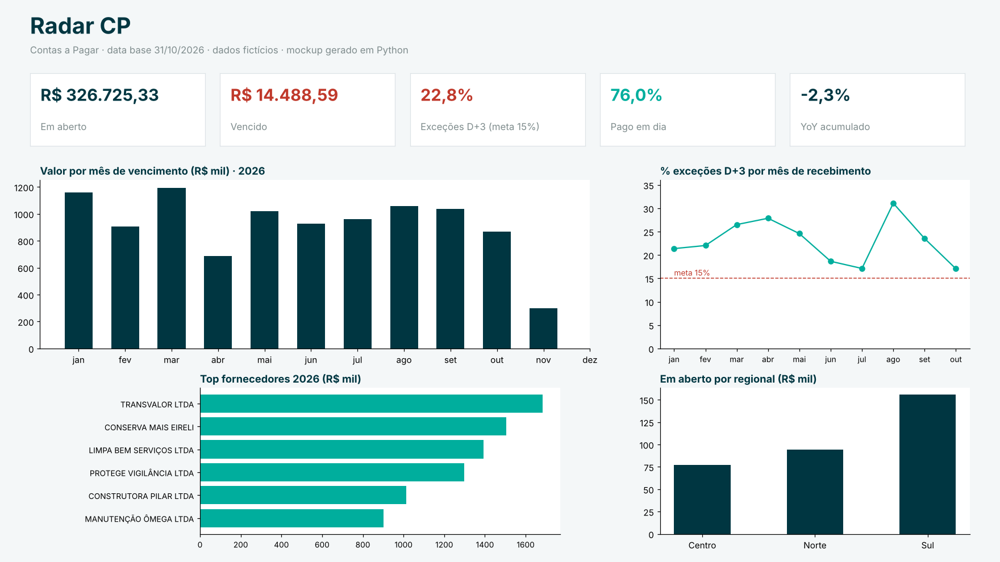

# Radar CP: painel de Contas a Pagar em Power BI

  

Painel gerencial do Contas a Pagar de uma cooperativa de crédito: saldo em aberto e vencido, **regra D+3** (documentos que chegam com menos de 3 dias para o vencimento), pontualidade, despesas administrativas com comparativo anual, curva ABC, aging e conciliação entre pagamento e contabilização.

O painel original está publicado no Power BI Service da empresa, com atualização agendada. Este repositório traz a **engenharia do painel**, toda em texto versionável: Power Query (M), medidas DAX, modelo de dados, especificação das páginas e um conjunto de dados fictícios para reproduzi-lo.

> **Dados fictícios** (os mesmos do projeto [`sql-analise-contas-a-pagar`](https://github.com/Gabriel9719/sql-analise-contas-a-pagar)). Nenhum valor, fornecedor ou pessoa é real.


*Mockup da página Resumo gerado em Python com os dados fictícios (`scripts/referencia_e_mockup.py`).*

## O que tem aqui

| Pasta | Conteúdo |
|---|---|
| [`powerquery/`](powerquery) | Parâmetro de pasta, função `fxLerCsv` reutilizável, fatos, dimensões e um **calendário contínuo** gerado em M |
| [`dax/medidas.dax`](dax/medidas.dax) | ~25 medidas comentadas: base, D+3 × meta, pontualidade, MoM, YTD/YoY em período equivalente, ABC dinâmica, aging com tabela desconectada, conciliação e produtividade ponderada |
| [`docs/modelo_e_paginas.md`](docs/modelo_e_paginas.md) | Modelo estrela, relacionamentos, **problemas reais resolvidos** e especificação das 6 páginas |
| [`docs/valores_referencia.md`](docs/valores_referencia.md) | Valores esperados das medidas, calculados em Python, para **testar o .pbix** |
| [`pbip/`](pbip) | **Projeto Power BI (PBIP)** pronto para abrir no Desktop: modelo, relacionamentos, medidas e 4 páginas |
| `data/` | CSVs fictícios (títulos, razão, fornecedores, PAs, contas) |

## Decisões técnicas que valem destaque

- **Uma tabela de datas, três perspectivas.** O relacionamento ativo é o de vencimento; pagamento e recebimento usam `USERELATIONSHIP` dentro das medidas. Todos os filtros são em direção única: o filtro bidirecional criava caminhos ambíguos e fazia o segmentador de ano falhar.
- **Variação mensal que não quebra em janeiro.** `DATEADD` sob o filtro de ano descartava dezembro; a medida troca o contexto com `REMOVEFILTERS(dCalendario)` e calcula a janela com `EOMONTH`.
- **Comparativo anual justo.** O acumulado do ano anterior vai só até o mesmo dia da data-base, e não até o ano inteiro.
- **Chave substituta de conta contábil.** O código reduzido foi reutilizado na reestruturação do plano de contas, então relacionar por ele misturava contas diferentes.
- **Colunas derivadas no Power Query, não em DAX.** As colunas `dias_antecedencia`, `excecao_d3` e `dias_atraso` comprimem melhor e não pesam no recálculo.
- **Testabilidade.** Os valores de referência em Python permitem conferir cada cartão do painel depois de qualquer mudança no modelo.

## Como abrir no Power BI Desktop

O projeto está em [`pbip/`](pbip) no formato **Power BI Project (PBIP)**: o modelo (`model.bim`) e o relatório (`report.json`) ficam em texto e são versionados no Git. Eles são gerados por código (`scripts/gerar_pbip.py`) a partir das consultas M e das medidas DAX deste repositório.

1. Clone o repositório e abra `pbip/RadarCP.pbip` no Power BI Desktop.
2. Em *Transformar dados › Editar parâmetros*, aponte **PastaDados** para a pasta `data\` do seu clone (ou gere de novo com `python scripts/gerar_pbip.py --pasta-dados "C:\caminho\data\"`).
3. Clique em **Atualizar**. São 4 páginas: Resumo, Exceções D+3, Despesas e ABC, Aging e conciliação.
4. Confira os cartões contra [`docs/valores_referencia.md`](docs/valores_referencia.md). Para ter um `.pbix`, use *Arquivo › Salvar como*.

```bash
pip install -r requirements.txt
python scripts/referencia_e_mockup.py   # recalcula referência e mockup
pytest -q
```

## Stack

Power BI (Power Query M, DAX, modelagem dimensional) · Python (pandas, matplotlib) para referência e mockup · pytest

---
Autor: **Gabriel Antônio Ribeiro**, Analista Financeiro · [LinkedIn](https://www.linkedin.com/in/gabriel-ant%C3%B4nio-ribeiro-017808210)
